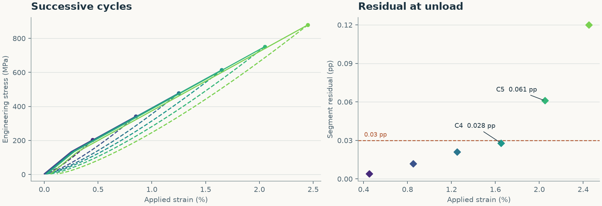
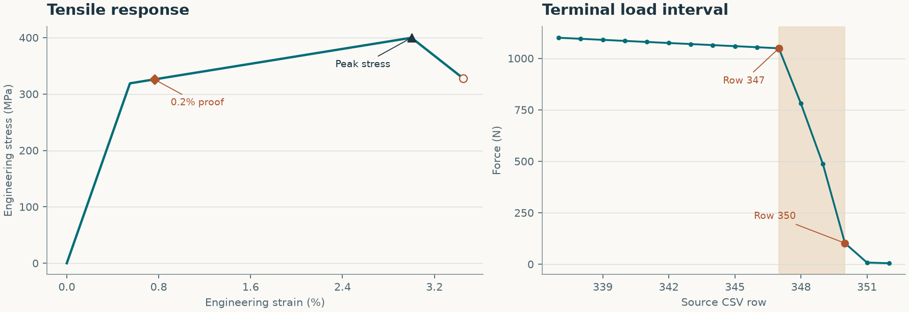
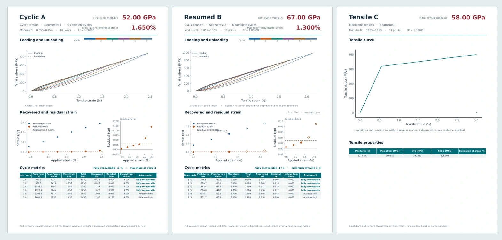
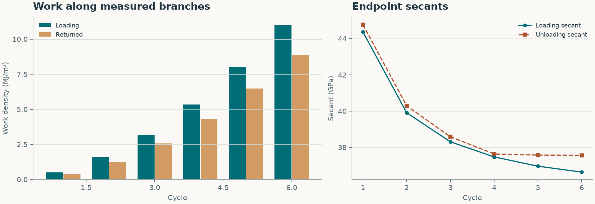
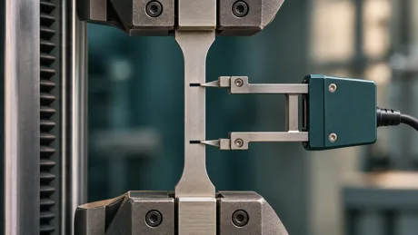
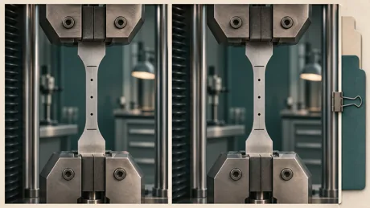
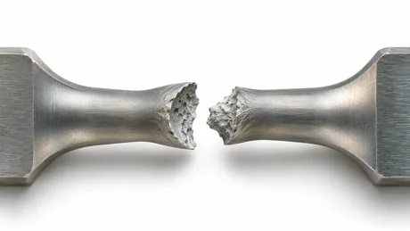

# MechCurve

**Cyclic loading and tensile fracture, one page per specimen.** Give a local agent an instrument export. MechCurve follows the loading history, measures how much strain returns after each unload, and links the yield point, stress maximum and terminal load drop to the original observations.

[简体中文](README.zh-CN.md) · [Open the three specimen sheets](assets/showcase/specimen-sheets.en.pdf) · [Run the demo](#run-the-demo) · [Agent setup](docs/agent.md)


## How far did the specimen recover?

**Cyclic A** reaches 1.650% applied strain on cycle 4 and returns to a residual of 0.028 percentage points at its measured unload stress. Cycle 5 reaches 2.050% and leaves 0.061 points. At the chosen **residual < 0.030 pp** criterion, cycle 4 is the highest observed qualifying cycle. Its first-loading tensile modulus is **52.00 GPa**, fitted from 0.05% to 0.15% strain increment.

[](assets/showcase/cyclic-detail.en.pdf)

The PDF keeps the specimen's first loading, resumed acquisitions and repeated targets together. **Resumed B** visited the same 1.3% target twice. Its measured peak stresses were 636.56 and 642.85 MPa. Both visits retain their own unload rows and segment references. Suspected trial acquisitions remain available in the detailed outputs. [Resumed-history figure](assets/showcase/resumed-history.pdf) · [Cycle and recovery methods](docs/methods.md)

## Where did the tensile test end?

**Tensile C** reaches 399.85 MPa at 3.000% strain on row 302. Loading continues along a softening branch. The last observation before the sharp drop is row 347 at 327.85 MPa and 3.450% strain. By row 350 the force has fallen 90.2%. The synthetic experimenter's note independently confirms the break.

[](assets/showcase/tensile-detail.en.pdf)

A curve-only drop stays a candidate. A test can also end under load without a located break. The report distinguishes the **pre-event extensometer strain** from **post-break gauge elongation** (2.900% here). The latter uses the measured gauge lengths on a confirmed fractured specimen. [Read the tensile specimen report](assets/showcase/tensile-detail.en.pdf) · [Inspect the source CSV](examples/demo/tensile-c.csv)

## Read the three specimen sheets

[](assets/showcase/specimen-sheets.en.pdf)

| Follow a measurement | Find in the delivery |
| --- | --- |
| First loading and recovery limit | Modulus fit rows, R², all ties at the highest qualifying strain and the first complete cycle outside the limit in `axial-summary.json` |
| Work and stiffness in a loop | Loading and unloading endpoint secants, loading work, returned work and signed net work in `cycle-branches.csv` |
| Fracture and proof stress | Status and basis, pre-drop and low-signal rows, Rp0.2 interpolation bracket and strain at peak stress |

<details>
<summary>See how branch work and endpoint secants change over the six cycles</summary>



Work is integrated along the measured engineering stress–strain path. A cycle with a residual endpoint is open. Its signed net work includes the effect of those differing endpoints. The first-loading modulus uses a separate linear fit. [Definitions and units](docs/methods.md)

</details>

## Run the demo

From the repository root with Python 3.11 or later:

```sh
python -m venv .venv
# Linux / macOS
source .venv/bin/activate
# Windows PowerShell: .\.venv\Scripts\Activate.ps1
python -m pip install -e ".[agent]"
mechcurve analyze examples/demo --notes examples/demo/notes.json --lang en
```

Open **examples/demo_MechCurve/open-results.html**. Replace `RUN` below with the versioned directory returned by the command:

```sh
mechcurve summary RUN --sample "Cyclic A"
mechcurve evidence RUN --record tensile-c.csv --row 347 --radius 3
mechcurve verify RUN
```

A useful agent request is *“Analyze this folder, group known resumed acquisitions, give me the highest qualifying cycle for each specimen, and show the original rows supporting any fracture call.”* The stdio MCP server supports the same inspection, analysis and evidence queries. [Agent tools](docs/agent.md) · [Runnable specimen notes](examples/demo/notes.json)

### At the test bench

| Gauge reference | Repeated target | Fracture evidence |
| --- | --- | --- |
| [](docs/methods.md) | [](assets/showcase/resumed-history.pdf) | [](assets/showcase/terminal-event.pdf) |
| Preserve the strain reference. | Keep both visits. | Check the terminal rows. |

The cover and laboratory illustrations are conceptual artwork. All numerical figures above come from the public synthetic CSVs. CSV, TSV, TXT and visible Excel worksheets are supported. Additional workflows cover compression, flexure, torsion, creep, relaxation, fatigue and other measured channels. [Mixed-protocol examples](assets/showcase/protocol-sheets.en.pdf) · [Protocol catalog](docs/protocols.md) · [Full gallery](docs/gallery.md)

To regenerate the guide figures, run `python examples/render_axial_guide.py RUN OUTPUT_FOLDER` on the analyzed axial demo. Chinese reports use `--lang zh` (default) and a CJK font. [Campaign report](assets/showcase/campaign-report.en.pdf) · [MIT license](LICENSE)
