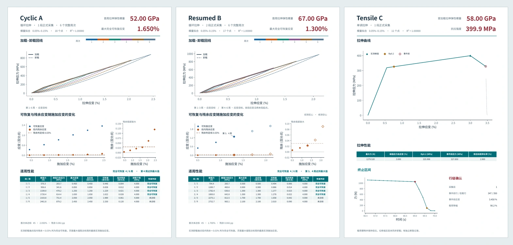

# MechCurve 力学曲线分析

[English](README.md) · [样品单页 PDF](assets/showcase/specimen-sheets.zh.pdf) · [指标定义](docs/methods.md) · [图册](docs/gallery.md)


**每个物理样品一页纸。** 将循环加载或单调拉伸导出的文件夹交给本地 Agent，MechCurve 会定位加载换向与卸载端点，拟合首加载模量，生成包含应力–应变曲线、恢复散点和逐周性能的 PDF。报告中的关键事件可以追溯到采集文件和原始 CSV 行。

### 实际输出



公开示例中，**Cyclic A** 的首周模量为 **52.00 GPa**。施加应变为 1.65% 时，实测卸载端点对应的段内残余为 0.028 个百分点；加载到 2.05% 后，残余增至 0.061 个百分点。因此样品页突出显示 **1.650%**，即已观测完整循环中达到 0.03 个百分点判据的最大施加应变。**Resumed B** 的两次采集共用一页，两次达到 1.3% 的记录分别保留。**Tensile C** 用预设的断裂说明和载荷骤降演示如何定位断裂前采样行。三组输入均由公开脚本合成。

[打开三张中文样品页](assets/showcase/specimen-sheets.zh.pdf) · [阅读中文批次报告](assets/showcase/campaign-report.zh.pdf) · [查看六种软件出图](docs/gallery.md#software-output)

### 运行示例

需要 Python 3.11 或以上版本。在项目目录中执行：

```powershell
python -m venv .venv
.\.venv\Scripts\Activate.ps1
python -m pip install -e ".[agent]"
mechcurve inspect examples/demo
mechcurve analyze examples/demo --notes examples/demo/notes.json --lang zh
```

Linux 或 macOS 用 `source .venv/bin/activate` 激活环境。中文图文可使用微软雅黑或 Noto Sans CJK SC，也可以将 `MECHCURVE_FONT` 指向本机字体文件。运行结束后，打开 **examples/demo_MechCurve/打开分析结果.html**，即可离线查看 PDF、矢量图、CSV 和 JSON。用返回的 run 目录替换下方的 RUN_DIRECTORY，可以逐周核对续测交界处的重复目标。

```sh
mechcurve cycles RUN_DIRECTORY --record resumed-b1.csv --cycle 3
mechcurve cycles RUN_DIRECTORY --record resumed-b2.csv --cycle 4
mechcurve verify RUN_DIRECTORY
```

### 分析自己的实验

| 输入 | 输出 |
| --- | --- |
| 含时间、载荷或应力通道的 CSV，可选应变、位移和 Bluehill 配套文件 | 归一化单位、峰值、加载阶段和原始行号 |
| 完整加载与卸载记录 | 逐周回线、峰值力及对应应力应变、换向点、卸载端点、总应变、可恢复和残余应变 |
| 同一试样的身份与采集顺序 | 一页合并历史、连续周次编号、各段实测应变参考点 |
| 拉伸过程和可用的断裂依据 | 首加载弹性模量、满足取值条件的拉伸性能、终止区间判读图 |
| 含初始试运行的批次 | 正式样品出图、试运行判定理由、可回查的试运行逐点和逐周记录 |

使用 `mechcurve analyze INPUT_FOLDER --notes NOTES.json --output OUTPUT_FOLDER --lang zh`。结果放在输入目录之外。报告包含首加载 0.05%–0.15% 窗口的点数、拟合质量及原始行号。完全可恢复按完整周卸载端点的有符号段内残余严格小于 0.03 个百分点判定。[指标定义与适用范围](docs/methods.md) · [可运行的备注示例](examples/demo/notes.json)

### 接入 Agent

支持命令行的 Agent 可以直接调用 CLI。支持 MCP 的宿主可以启动本地 stdio 服务，执行目录发现、整批分析、按周查询、原始行查询及结果核验。数值计算在本机完成。Agent 写入补充解释时附采集记录与行号。重跑时分别校验并复用数值记录、采集段图、样品详报、样品单页和续测合并图。[配置方法及示例](docs/agent.md)

### 复现与开发

```sh
python examples/generate_demo.py
python -m pip install -e ".[agent,test]"
python -m pytest -q
```

项目图册收录六种合成数据出图与十二张实验概念插图。[浏览图册和插图来源](docs/gallery.md) · [MIT 开源许可](LICENSE)
