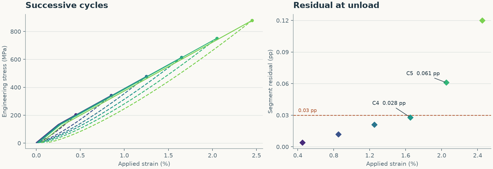
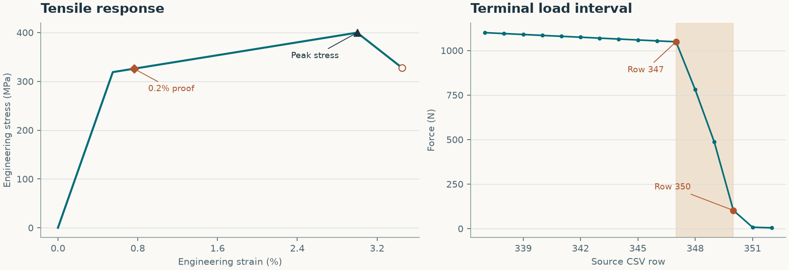
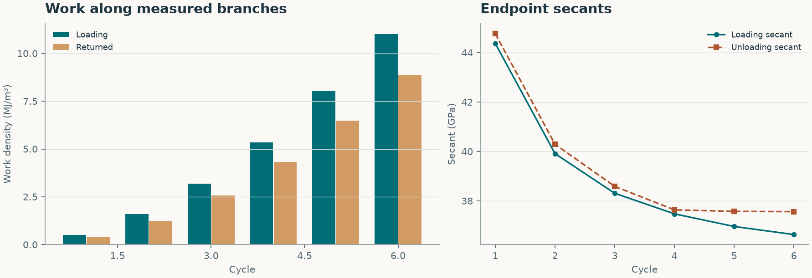
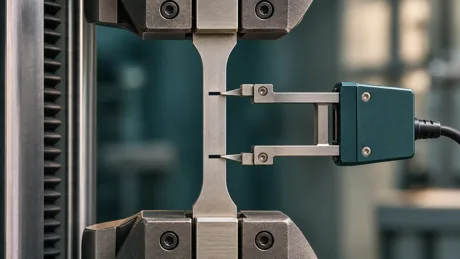
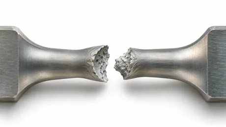

# MechCurve 力学曲线分析

**循环加载和拉断，每个物理样品一页纸。** 把试验机导出的文件交给本地 Agent，即可逐周查看加载到了哪里、卸载后恢复了多少，并从屈服、峰值和断裂判读回到原始采样行。

[English](README.md) · [打开三页中文样品报告](assets/showcase/specimen-sheets.zh.pdf) · [运行示例](#运行示例) · [接入 Agent](docs/agent.md)


## 这个样品最大能完全恢复到多大施加应变？

**Cyclic A** 在第 4 周加载到 1.650%，卸载到实测下限后残余为 0.028 个百分点。第 5 周加载到 2.050%，残余增至 0.061 个百分点。按**段内残余严格小于 0.030 个百分点**的判据，第 4 周是已测完整循环中施加应变最高的达标周。首加载支在 0.05%–0.15% 应变增量内拟合，拉伸弹性模量为 **52.00 GPa**。

[](assets/showcase/cyclic-detail.zh.pdf)

同一样品的续测放在同一页。**Resumed B** 两次加载到 1.3% 目标，峰值应力分别为 636.56 和 642.85 MPa。两次观测各自保留卸载端点和应变参考点。疑似初始试运行也可以在详报中回查。[续测合并图](assets/showcase/resumed-history.pdf) · [循环指标定义](docs/methods.md)

## 峰值、屈服和拉断分别发生在哪里？

**Tensile C** 在原始第 302 行达到 399.85 MPa，此时应变为 3.000%。随后应力下降，应变继续增加。骤降前最后一行是第 347 行，应力为 327.85 MPa，应变为 3.450%。到第 350 行，载荷下降了 90.2%。本合成示例另有独立的试验备注确认发生拉断。

[](assets/showcase/tensile-detail.zh.pdf)

仅凭曲线发现的骤降标记为候选。采集在高载下结束时，报告会说明能否定位断裂行。样品页分别列出**事件前引伸计应变**和**断后标距伸长率**；示例中后者由 30.00 mm 和 30.87 mm 算得 **2.900%**。[拉断样品详报](assets/showcase/tensile-detail.zh.pdf) · [查看原始 CSV](examples/demo/tensile-c.csv)

## 三张样品页

[](assets/showcase/specimen-sheets.zh.pdf)

| 想查什么 | 到哪里看 |
| --- | --- |
| 首周模量和完全可恢复应变 | 页首红色数值；`axial-summary.json` 可查拟合行、R²、并列最高达标周和首次未达标周 |
| 循环中做了多少功、刚度如何变化 | `cycle-branches.csv` 给出加载与卸载割线、加载功、返回功、净功以及三个端点的原始行 |
| 拉断或屈服的依据 | 样品详报、骤降区间图，以及 Rp0.2 插值的两行、峰值应力处应变、骤降前后的行号 |

<details>
<summary>展开看六个完整循环的分支功与割线模量</summary>



路径功按工程应力对无量纲工程应变积分。卸载后存在残余时，路径未闭合，净功包含起终状态不同的影响。首加载弹性模量独立使用线性拟合计算。[计算定义与单位](docs/methods.md)

</details>

## 运行示例

在项目根目录运行，需要 Python 3.11 或以上版本：

```powershell
python -m venv .venv
.\.venv\Scripts\Activate.ps1
python -m pip install -e ".[agent]"
mechcurve analyze examples/demo --notes examples/demo/notes.json --lang zh
```

Linux 和 macOS 可以用 `source .venv/bin/activate` 激活环境。打开 **examples/demo_MechCurve/打开分析结果.html**。将下面的 `RUN` 换成命令返回的版本目录，即可按样品读摘要或查原始行：

```sh
mechcurve summary RUN --sample "Cyclic A"
mechcurve evidence RUN --record tensile-c.csv --row 347 --radius 3
mechcurve verify RUN
```

也可以直接交代给 Agent：“分析这个文件夹，按已知样品身份合并续测；列出每个样品最高达标周，并指出拉断判定能追溯到哪些原始行。” 本地 MCP 服务支持同样的目录检查、分析和回查。[Agent 工具](docs/agent.md) · [可运行的样品备注](examples/demo/notes.json)

### 从试验台读回曲线

| 标距基准 | 续测交界 | 断裂证据 |
| --- | --- | --- |
| [](docs/methods.md) | [](assets/showcase/resumed-history.pdf) | [](assets/showcase/terminal-event.pdf) |
| 核对原始应变参考点 | 保留同一目标的两次观测 | 对照载荷骤降前后的原始行 |

封面和试验台插图为概念示意。上文的定量图全部由公开合成 CSV 计算生成。支持 CSV、TSV、TXT 和 Excel 可见工作表，也可分析压缩、弯曲、扭转、蠕变、松弛、疲劳等试验。[其他类型的十二页样张](assets/showcase/protocol-sheets.zh.pdf) · [试验类型与适用条件](docs/protocols.md) · [完整图册](docs/gallery.md)

基于已分析的公开轴向示例，可运行 `python examples/render_axial_guide.py RUN OUTPUT_FOLDER` 复现首页定量插图。中文报告使用本机中文字体，也可通过 `MECHCURVE_FONT` 指定字体文件。[中文批次报告](assets/showcase/campaign-report.zh.pdf) · [MIT 许可](LICENSE)
