# MechCurve gallery · 力学图册

[English README](../README.md) · [中文首页](../README.zh-CN.md)

## Software output

Each figure below comes from the bundled synthetic acquisitions. Click a preview to open the vector PDF. 数值图均由公开合成 CSV 动态生成。点开预览可查看矢量 PDF。

<table><tr><td width="50%"><a href="../assets/showcase/cyclic-history.pdf">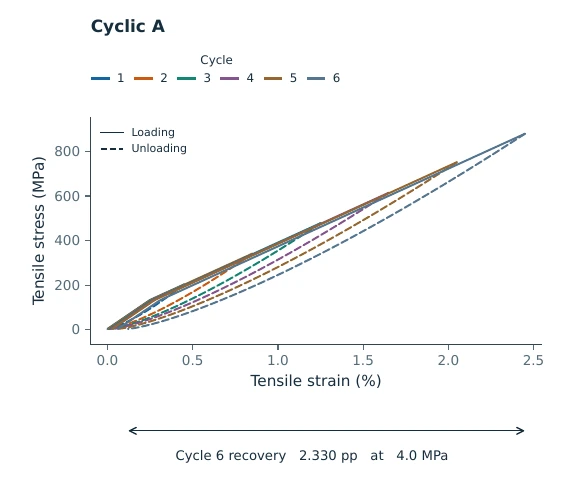</a> <strong>Cyclic stress–strain history · 循环应力–应变回线</strong> Six prescribed targets with separate loading and unloading branches.</td><td width="50%"><a href="../assets/showcase/modulus-window.pdf">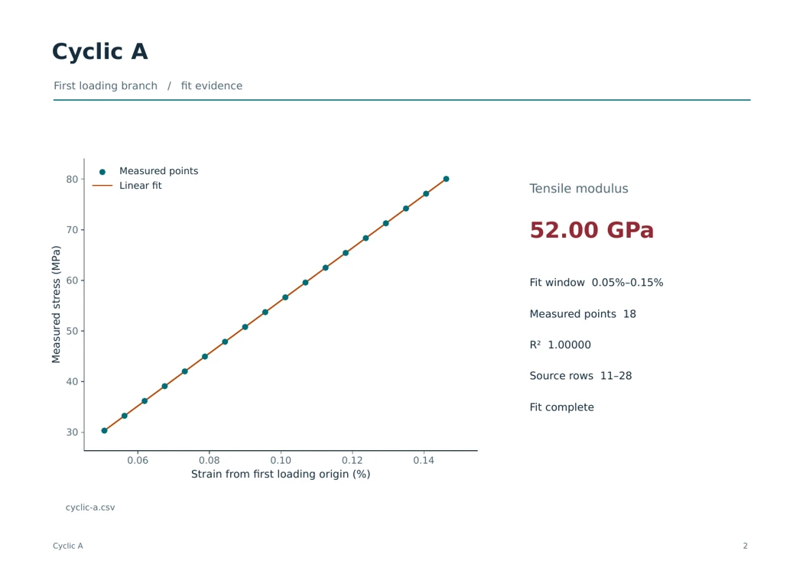</a> <strong>First-loading modulus · 首加载模量拟合</strong> The fitted points, window, slope and source-row range for Cyclic A.</td></tr></table>

<table><tr><td width="50%"><a href="../assets/showcase/strain-recovery.pdf">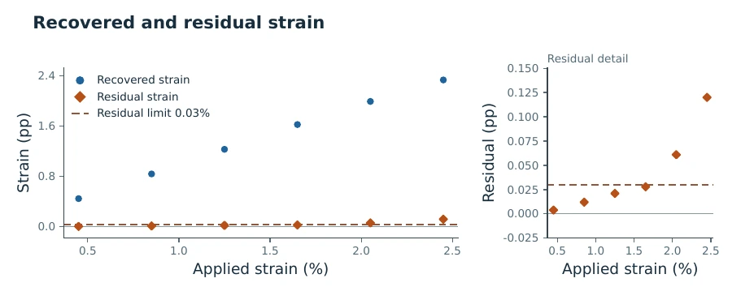</a> <strong>Strain recovery · 恢复散点及残余局部放大</strong> The scatter panel extracted from the specimen PDF, with its measured endpoints and strict cutoff.</td><td width="50%"><a href="../assets/showcase/resumed-history.pdf">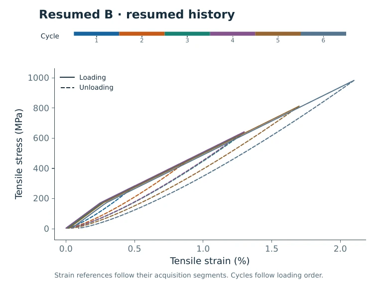</a> <strong>Two acquisitions, one specimen · 同一样品的分段续测</strong> Cycle numbers continue through the repeated 1.3% target.</td></tr></table>

<table><tr><td width="50%"><a href="../assets/showcase/terminal-event.pdf">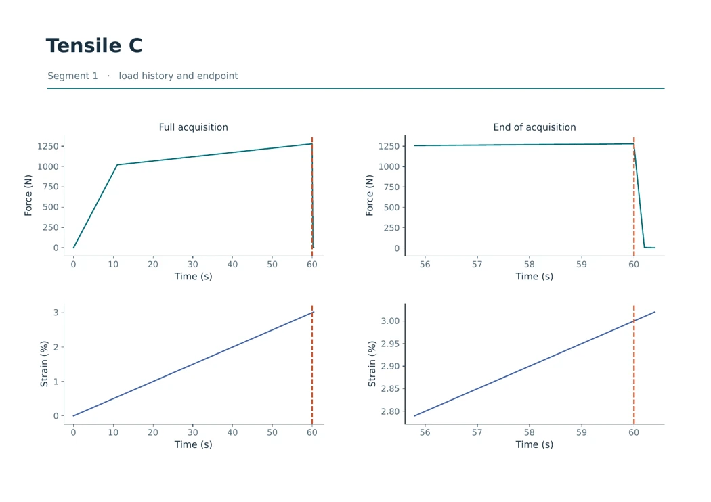</a> <strong>Termination diagnostic · 断裂前后时间历程</strong> A synthetic load drop with displacement history and a close view around the annotated event.</td><td width="50%"><a href="../assets/showcase/campaign-histories.pdf">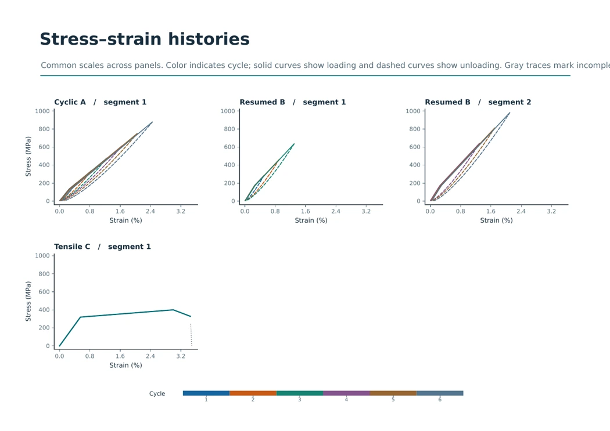</a> <strong>Campaign overview · 批次回线总览</strong> Four acquisition histories drawn with shared axis limits.</td></tr></table>

Editable vector examples · 可编辑矢量示例：[cyclic history](../assets/showcase/cyclic-history.svg) · [resumed history](../assets/showcase/resumed-history.svg)

## Concept illustrations · 实验概念插图

Twelve original ImageGen illustrations depict laboratory concepts. They are illustrative artwork. Numerical plots and sample results are available above. Click each thumbnail for the original-resolution WebP. 十二张独立生成的实验示意图可点开看高清版。构图与提示词可查阅 [illustration prompts](illustration-prompts.json)。

<table><tr><td width="33%"> <strong>Tensile coupon · 拉伸试样</strong></td><td width="33%"><a href="../assets/gallery/02-wire-grips.webp">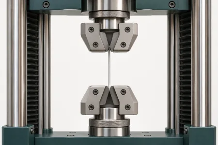</a> <strong>Wire in wedge grips · 丝材夹持</strong></td><td width="33%"><a href="../assets/gallery/03-gauge.webp">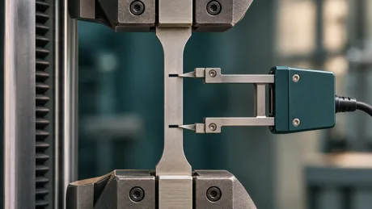</a> <strong>Gauge length · 标距测量</strong></td></tr></table>

<table><tr><td width="33%"><a href="../assets/gallery/04-loading.webp">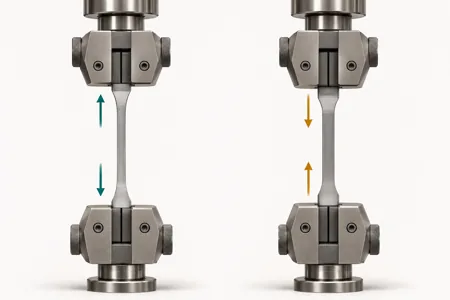</a> <strong>Load and unload · 加载与卸载方向</strong></td><td width="33%"><a href="../assets/gallery/05-cycles.webp">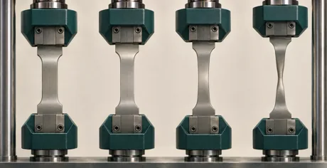</a> <strong>A sequence of loading states · 连续加载状态</strong></td><td width="33%"><a href="../assets/gallery/06-unload-end.webp">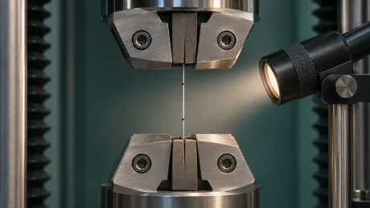</a> <strong>Unload endpoint · 卸载端点</strong></td></tr></table>

<table><tr><td width="33%"><a href="../assets/gallery/07-recovery.webp">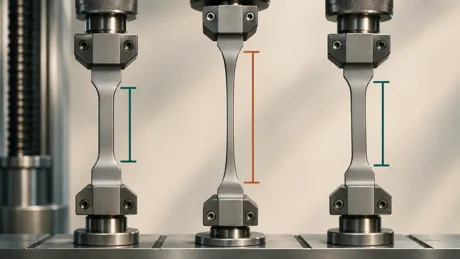</a> <strong>Recovery after loading · 卸载后的尺寸恢复</strong></td><td width="33%"> <strong>First-loading measurement · 首加载应变测量</strong></td><td width="33%"><a href="../assets/gallery/09-resume.webp">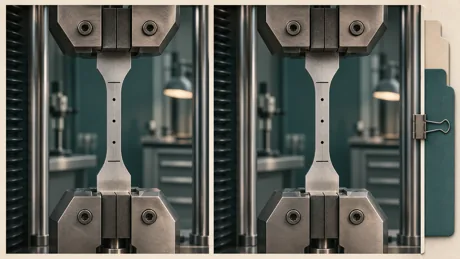</a> <strong>Resuming an acquisition · 续测与样品身份</strong></td></tr></table>

<table><tr><td width="33%"><a href="../assets/gallery/10-fracture.webp">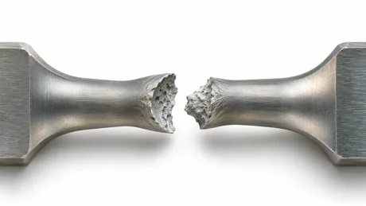</a> <strong>Separated specimen · 拉断后的试样</strong></td><td width="33%"> <strong>From acquisition to report · 从采集到报告</strong></td><td width="33%"> <strong>The laboratory report · 实验报告交付</strong></td></tr></table>

## Font notices

Public English PDFs embed subsets of DejaVu Sans. Chinese PDFs embed subsets of Noto Sans SC. The font notices accompany the downloadable examples. [DejaVu license](font-licenses/DejaVu.txt) · [Noto Sans SC license](font-licenses/NotoSansSC.txt)
